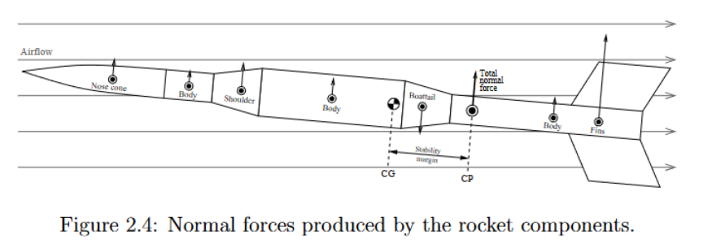

# OpenRocket Technical Documentation Chapter 2.4 : Stability of a Rocket
##  Reading Notes : 

### if the CP is located aft of the CG. If this condition holds, the rocket is said to be statically stable. A statically stable rocket always produces a corrective moment when flying at a small angle of attack. (The angle of attack is the angle between the centerline of the rocket or longitudinal axis and the direction of the velocity vector).

### The argument for static stability above may fail in two conditions: First, the normal forces might cancel each other out exactly, in which case a moment would be produced but with zero total force. Second, the normal force at the CP might be in the wrong direction (downward in the figure), yielding an uncorrective moment. 

### The stability margin of a rocket is defined as the distance between the CP and CG, measured in calibers, where one caliber is the maximum body diameter of the rocket.A rule of thumb among model rocketeers is that the CP should be approximately 1–2 calibers aft of the CG.The CP of a rocket typically moves upwards as the angle of attack increases.

# OpenRocket Technical Documentation Chapter 3.1 and 3.2 : Aerodynamic properties / Normal forces and pitching
##  Reading Notes : 

